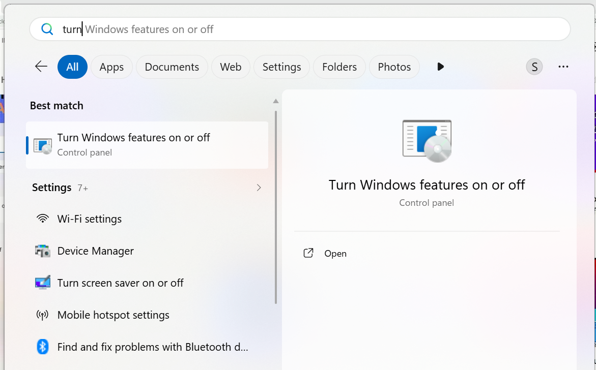
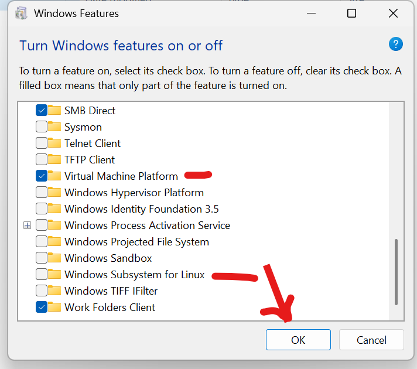
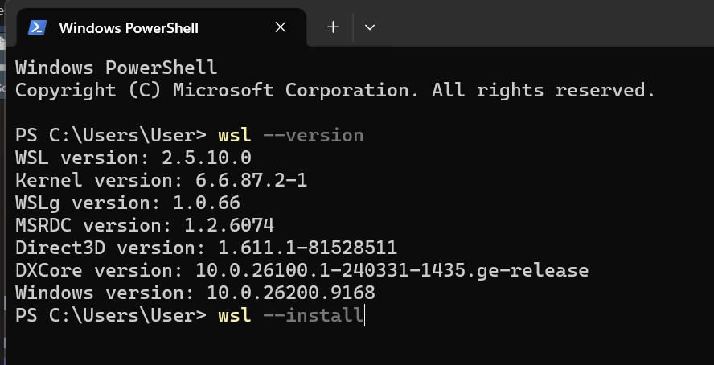
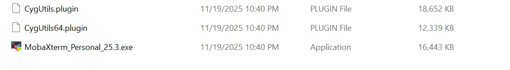
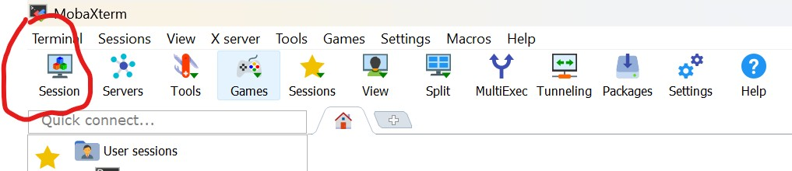
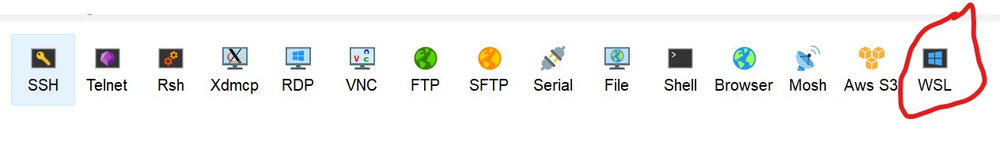
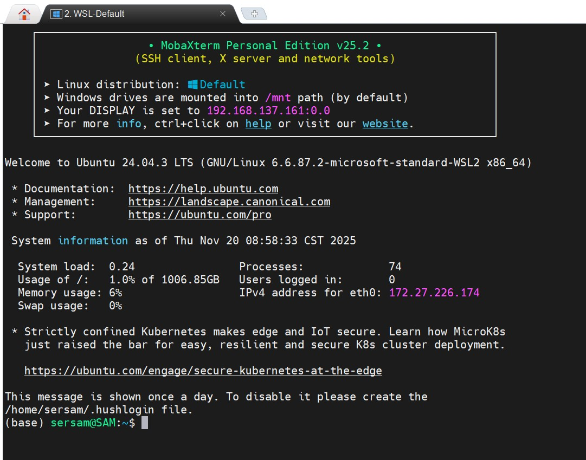
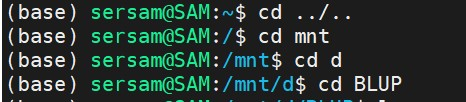

# Short introduction to BLUPF90 programs

A short introduction of the programs is provided by `Yutaka Masuda` at <https://masuday.github.io/blupf90_tutorial/introduction_short.html#short-introduction-to-blupf90-programs>.

Briefly as quoted from his text "BLUPF90 is the name of the software. It is also the name of a collection of programs derived from BLUPF90. In the latter case, we will refer to it as the *BLUPF90 family* or *BLUPF90 programs*. A concise description can also be found on the official wiki at the University of Georgia (<http://nce.ads.uga.edu/wiki/doku.php>).

> BLUPF90 family of programs is a collection of software in Fortran 90/95 for mixed model computations in animal breeding. The goal of the software is to be as simple as with a matrix package and as efficient as in a programming language.

The BLUPF90 program creates and solves mixed model equations. It supports various models including the animal model, maternal model, and random regression model with multiple traits. The BLUPF90 family includes several programs for variance component estimation using REML and Gibbs sampling with various models. The set of programs is available on the official website ([http://nce.ads.uga.edu](http://nce.ads.uga.edu/)) and can be freely used for academic or research purposes."

# Preparing for the course

## A basic procedure

If you have no experience running a command line program.

Running a command-line program is actually a frequently asked question. The standard method is to use the Command Prompt, or simply `cmd`, which is a console that accepts commands typed with a keyboard. You can also use PowerShell instead of Command Prompt; the procedure is the same.

There are many tutorials available on this topic:

- Command Prompt - How to Use Basic Commands\
  (<http://www.digitalcitizen.life/command-prompt-how-use-basic-commands>)

- How to use the Windows command line (DOS)\
  (<http://www.computerhope.com/issues/chusedos.htm>)

- How do I run a file from MS-DOS?\
  (<http://www.computerhope.com/issues/ch000598.htm>)

- Beginners Guide: Windows Command Prompt\
  (<http://www.pcstats.com/articleview.cfm?articleID=1723>)

- How to Open Command Prompt\
  (<http://pcsupport.about.com/od/commandlinereference/f/open-command-prompt.htm>)

## Installing Ubuntu

Step 1. First turn on the relevant windows features

{fig-align="center" width="400"}

Step 2. Turn on "Virtual Machine platform" first and click ok then proceed to step 3. If the linux does not run perfectly on Mobaxterm after this then you can also come back to this step and turn on "Windows subsystem for Linux" and proceed with the subsequent steps.

{fig-align="center" width="400"}

Step 3. Windows completes the requested changes. Restart your computer

{fig-align="center" width="400"}

## Installing the linux subsystem

Open windows powershell and first check the current version of WSL that you have (not neccessary)

Type `wsl --install` and hit `ENTER` to install. The installation may take a couple of minutes depending on your internet speed.

{fig-align="center" width="400"}

## Installing [MobaXterm](https://download.mobatek.net/2532025092512146/MobaXterm_Portable_v25.3.zip){.uri}

Download [MobaXterm](https://download.mobatek.net/2532025092512146/MobaXterm_Portable_v25.3.zip){.uri} Home Edition (current version) at: <https://download.mobatek.net/2532025092512146/MobaXterm_Portable_v25.3.zip>

After download the software extract the zip file and install the software.\


## Download and Run BLUPF90 family of programs

For the best and up-to-date method of installing the software please visit the official BLUPF90 website.

No special installation procedure is required. Just download the program from the official website. Then, change the file permissions using `chmod`, for example, `chmod 755` or `chmod u+x` (a helpful way to remember: *ch_ange the mod_e to add execution permission +x* for the \_u_ser). You can move the program to your preferred directory, which may already be listed in your `PATH` environment variable. If not, you can create such a directory and move the program there.

### OPTION 1. Recommended

File [blupf90_win.zip](https://nce.ads.uga.edu/wiki/lib/exe/fetch.php?media=blupf90_win.zip "blupf90_win.zip (67.7 MB)") contains Windows executables + GNUPLOT; an included script file sets access to all binaries and the graphing package. At this time, the best compiler appears to be from Intel; it is free for noncommercial use in Linux.

download the programs from the above link and store them in any `D` drive folder of your choice.\

after installing `MobaXterm` and having dowloaded the file here is an example of how you can install the files.

1.  Copy the files to your working directory on your D drive

2.  Open MobaXterm \>\> Sessions \>\> WSL

    

    

3.  Navigate to your working directory. When you open MobaXterm, you'll see something like:

    `(base) sersam@SAM:/$`

    

    1.  To navigate to your blup folder in D drive if you have not created it, create it first:

        then inside WSL move back to the root folder and then navigate to your folder

        1.  `cd ../..`

        2.  `cd /mnt/d/blup/`

            

4.  Navigate through sub-directories to find the executable. Use `cd` to move through folders until you reach the bin directory

    Example:

    `cd blupf90_win/blupf90_win/bin/`

5.  List files to verify you're in the right directory

    `ls`

6.  You should see executables like:

    `airemlf90.exe blupf90.exe renumf90.exe etc.`

7.  Move back one directory level

    `cd ..`

8.  Make all programs in the bin directory executable

    `chmod +x bin/`

    `chmod 755 bin/`

9.  Verify the programs are now executable by testing one

    `renumf90 --help`

10. Create a directory for binaries in your home directory

    `mkdir -p ~/bin`

11. Move the programs to your binary directory

    `mv bin/* ~/bin`

12. Add the binary directory to your PATH (optional but recommended)

    `echo 'export PATH="$HOME/bin:$PATH"' >> ~/.bashrc`

    `source ~/.bashrc`

### OPTION 2: Download programs individually

download the programs from here and store them in one folder. <https://nce.ads.uga.edu/html/projects/programs/Linux/64bit/>\

1.  Download programs from: <https://nce.ads.uga.edu/html/projects/programs/Linux/64bit/>

Download all required executables (e.g., renumf90, blupf90, airemlf90, etc.) and store them in a single folder

2.  Navigate to the folder containing the downloaded programs

    `cd /path/to/your/downloaded/programs`

3.  List files to verify all programs are present

    `ls`

4.  Make all programs executable

    `chmod +x *`

5.  Create a directory for binaries in your home directory

    `mkdir -p ~/bin`

6.  Move all programs to the binary directory

    `mv * ~/bin`

7.  Check if `~/bin` is in your PATH

    `echo $PATH`

8.  If `~/bin` is not in your PATH, add it

    `echo 'export PATH="$HOME/bin:$PATH"' >> ~/.bashrc`

    `source ~/.bashrc`

9.  Verify installation by testing a program

    `renumf90 --help`

### OPTION 3: Direct installation from BLUPF90 website

The BLUPF90 website also has the following method for the installation

1.  Download the program (you can use wget or other tools like curl)

    `wget http://nce.ads.uga.edu/html/projects/programs/Mac_OSX/new/blupf90`

Alternative using curl:

`curl -O http://nce.ads.uga.edu/html/projects/programs/Mac_OSX/new/blupf90`

2.  Change the permission to make it executable

    `chmod 755 blupf90`

    `chmod +x blupf90`

3.  Create a directory for binaries, if it doesn't exist

    `mkdir -p ~/bin`

4.  Move the program to that directory

    `mv blupf90 ~/bin`

5.  Check if `~/bin` directory is in your PATH environment variable

    `echo $PATH`

6.  If `~/bin` is not in your PATH, add it (optional but recommended)

    `echo 'export PATH="$HOME/bin:$PATH"' >> ~/.bashrc`

    `source ~/.bashrc`

7.  Verify the installation was successful

    `blupf90 --help`

### OPTION 4. The basic procedure.

A basic procedure to run the program which might work for this lecture in particular but for larger (not big) data sets it might not be compatible is as follows:

1.  Download the program and save it in a folder.\
    (You may optionally add the folder to your system `PATH`. If you’re unsure what this is, you can skip this step.)

2.  Save the required files in the same folder.

3.  Open the Command Prompt and use the `cd` command to change to the folder’s directory.

4.  Type the name of the program (e.g., `blupf90` or `blupf90.exe`) to launch it.

5.  When prompted, type the name of the parameter file. Some programs may ask for additional input.

6.  Wait for the analysis to complete.

7.  Check and collect the results.

If the program runs successfully, it will ask you for the name of the parameter file with the following prompt:

```         
 name of parameter file?
```

## Enhanced editor for Windows users

Common text editors include *Notepad* (Windows), *TextEdit* (macOS), and *vi*, *Emacs*, or *nano* (Linux/Unix). These are the default editors on each system, but you can install other editors for convenience. Notepad, in particular, has too few features to be practical in many cases. There are many free, powerful text editors available for Windows and other platforms.

Below are several well-known and free text editors. Some of them are multi-platform and support Linux, macOS, and Windows. Try a few and choose the one that suits you best:

- Notepad++ ([https://notepad-plus-plus.org](https://notepad-plus-plus.org/)) — Windows only

- SciTE (<http://www.scintilla.org/SciTE.html>) — Windows

- Visual Studio Code ([https://code.visualstudio.com](https://code.visualstudio.com/)) — All platforms
